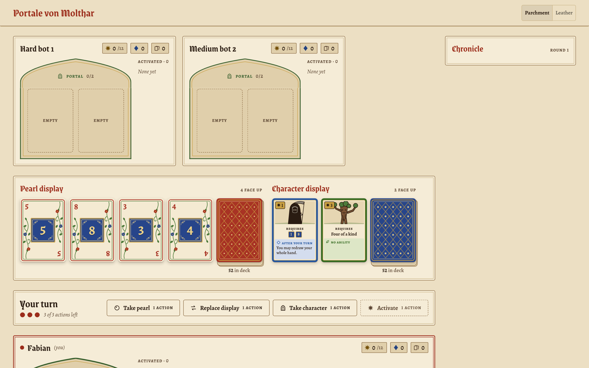
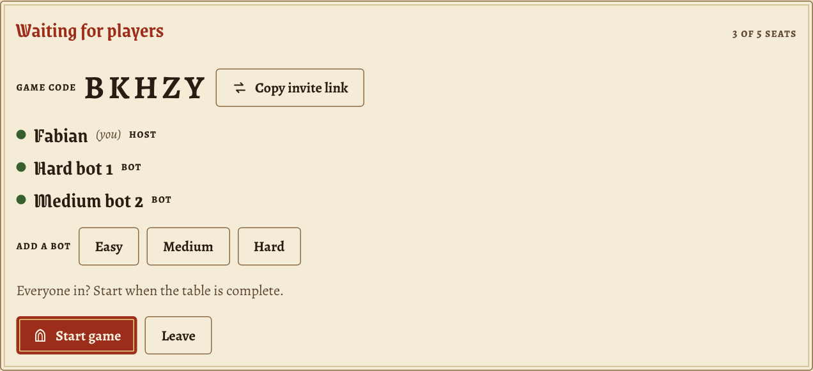
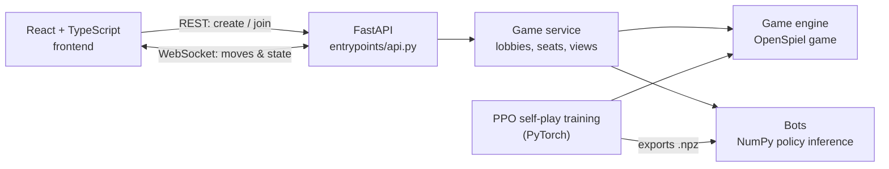

<h1 align="center">Portale von Molthar</h1>

<p align="center">
  The card game <em>Die Portale von Molthar</em>, playable online with friends or against a
  reinforcement-learning opponent trained through self-play.
</p>

<p align="center">
  <a href="https://portale-von-molthar.onrender.com/"><strong>▶ Play it in your browser</strong></a>
</p>

<p align="center">
  <picture>
    <source media="(prefers-color-scheme: dark)" srcset="docs/assets/table-leather.png">
    
  </picture>
</p>

<p align="center">
  
  
  
  
  
  
</p>

---

## Highlights

- **Full game implementation** All game rules from [`docs/RULES.md`](docs/RULES.md) are implemented as an [OpenSpiel](https://github.com/google-deepmind/open_spiel) (open-source library developed by Google Deepmind) game, so OpenSpiel algorithms and agents can easily play the game.
- **RL agents** We trained PPO (Proximal Policy Optimization) agents through self-play against a pool of its own past versions. It wins **98.4 %** of 1-vs-1 games against a random player and is competitive with a human player
- **Real-time online multiplayer.** You create a table, share the 5-letter code or the invite link, and play with friends. 
- **Bots** that can fill any empty seat. Easy, Medium and Hard all play the same trained policy at different sampling policies.
- **Frontend** in React and TypeScript.

<p align="center">
  
</p>


## Reinforcement Learning Agents

The agent is a policy-value MLP, [`agents/ppo.py`](src/portale_von_molthar/agents/ppo.py),
trained with Proximal Policy Optimization:

- **One network can play multiple seats** The observation includes a one-hot of the acting player, so one policy can play any seat and learns from all of them. Illegal moves are masked out before sampling.
- **Reward function** Each decision is rewarded by the change in
  *(own score − mean opponent score)*. This is potential-based shaping, which leaves the
  optimal strategy unchanged but gives feedback every turn. A small step cost discourages
  doing nothing, and the final win or loss is added at the end.
- **Opponent pool.** Every few updates we freeze a snapshot of the network and add it to a
  pool. Half of the training games are played against these snapshots, so the policy keeps
  beating its older versions instead of cycling between strategies.
- **No PyTorch needed at serve time.** The trained weights are exported to a small `.npz` file,
  and the server runs inference in NumPy.

| Matchup (1000 games, 1 vs 1)          | Win rate of the trained agent |
|---------------------------------------|:-----------------------------:|
| PPO agent (greedy) vs. random player  | **98.4 %**                    |

To train your own:

```bash
uv sync --extra train
python examples/train_ppo.py --updates 200          # → models/policy_2p.npz
```


## Architecture



| Layer    | Where                                 | What it does |
|----------|---------------------------------------|--------------|
| Engine   | `src/portale_von_molthar/game/`       | Rules, cards, abilities, payments, OpenSpiel state and observation tensor |
| Agents   | `src/portale_von_molthar/agents/`     | PPO training, policy export, random and policy bots |
| Services | `src/portale_von_molthar/services/`   | In-memory game sessions and the per-player views of the state (hidden information) |
| API      | `src/portale_von_molthar/entrypoints/`| FastAPI REST and WebSocket endpoints; also serves the built frontend |
| Frontend | `frontend/`                           | React UI and design system |


## Run it locally

```bash
uv pip install -e ".[server]"
uvicorn portale_von_molthar.entrypoints.api:app --reload   # API on :8000

cd frontend && npm install && npm run dev                  # UI on :5173
```

To run everything from one process, build the frontend once. The API then serves
`frontend/dist` at `/`:

```bash
cd frontend && npm run build && cd ..
uvicorn portale_von_molthar.entrypoints.api:app --host 0.0.0.0 --port 8000
```

<details>
<summary>Playing over Wi-Fi or the internet</summary>

**Same Wi-Fi:** find the host's IP address (`ipconfig getifaddr en0` on macOS). Everyone opens
`http://<that-ip>:8000`. Allow incoming connections if the firewall asks. Guest networks often
block traffic between devices.

**Over the internet:** while uvicorn is running, start
`cloudflared tunnel --url http://localhost:8000` (install it with `brew install cloudflared`)
and share the printed `https://….trycloudflare.com` URL.

Games live in memory, so restarting the server ends them.
</details>


## Development

```bash
uv pip install -e ".[dev]"
pre-commit install
pytest                                   # 318 tests
```

The pre-commit hooks run ruff, mypy, pylint, bandit, flake8-errmsg and nb-clean on every commit.
Tests in `tests/` mirror the package layout. See [`AGENTS.md`](AGENTS.md) for the coding
conventions. Versions come from git tags via `hatch-vcs`.


## Authors

**Moritz Weber** and **Fabian Schatz**


## Disclaimer

This is a non-commercial fan project. *Die Portale von Molthar* is designed by Johannes Schmidt
and published by AMIGO Spiele. All rights to the game belong to them. The card artwork in this
project is AI-generated.
